# 🤖 Awesome Embodied AI Benchmarks

 

 

**A Curated List of SaaS Platforms & Open-Source Benchmark Suites for Embodied Artificial Intelligence, Robotics, Manipulation, Navigation & Vision-Language-Action (VLA) Evaluation.**

*Tracking cutting-edge simulation environments, multi-modal physics engines, continuous-state manipulation benchmarks, and sim-to-real transfer protocols.*

📅 **Last updated: October 2026**

---

## 🧭 Table of Contents

- [📊 Sector Overview & Market Dynamics](#-sector-overview--market-dynamics)
- [☁️ SaaS / Hosted Evaluation Platforms](#️-saas--hosted-evaluation-platforms)
- [💻 Open-Source Benchmark Suites](#-open-source-benchmark-suites)
  - [Top Repositories Ranked by GitHub Stars](#top-repositories-ranked-by-github-stars)
- [💡 Choosing the Right Benchmark](#-choosing-the-right-benchmark)
- [🤝 How to Contribute](#-how-to-contribute)
- [💖 Support & Sponsorship](#-support--sponsorship)
- [⭐ Star History](#-star-history)
- [📜 Disclaimer](#-disclaimer)

---

## 📊 Sector Overview & Market Dynamics

The global Embodied AI and physics simulation software market is estimated at **$3.2B – $3.9B in 2025–2026**, growing at an accelerating CAGR of **~16–18%**, fueled by breakthroughs in Vision-Language-Action (VLA) foundation models, cross-embodiment imitation learning, and synthetic data generation pipelines. 

The sector displays a distinctive **hybrid market concentration**:
- **Highly Concentrated Core Infrastructure**: Foundational physics engines, photorealistic rendering layers, and distributed cloud simulation infrastructure are dominated by a handful of well-capitalized tech titans and research institutions (e.g., NVIDIA Isaac Sim/Omniverse, Meta AI Habitat, Google DeepMind MuJoCo/dm_control).
- **Fragmented Vertical & Hardware Layer**: Domain-specific robotics tasks, dexterous bimanual manipulation challenges, lifelong learning benchmarks, and varied hardware embodiments (humanoids, quadrupeds, wheeled mobile manipulators) remain **moderately to highly fragmented**, with active open-source competition and community-led benchmark development.

---

## ☁️ SaaS / Hosted Evaluation Platforms

Hosted evaluation benchmarks and cloud competition platforms allow researchers to submit models and evaluate policies directly on standardized remote infrastructure without requiring high-end on-premise GPU clusters.

| 🌐 Platform | 🏛️ Organization / Backer | 📈 Org Size (Revenue / Valuation) | 📝 Description | 💳 Pricing | 🎁 Free Tier Limits |
| :--- | :--- | :--- | :--- | :--- | :--- |
| **[Habitat Challenge](https://aihabitat.org/challenge/)** | Meta Platforms | ~$1.8T - $2.0T Market Cap (~$160B+ Rev) | Annual challenge and evaluation service evaluating uploaded embodied agents in unseen simulated environments via automated code execution. | $0 / Free (Research Platform) | Free forever; unlimited challenge phase submissions subject to EvalAI rate limit of 3–5 submissions/day per team |
| **[BEHAVIOR Challenge](https://behavior.stanford.edu/)** | Stanford University | $40.8B Endowment ($8.2B+ Op Budget) | Annual benchmark competition grounded in 1,000 human-surveyed daily activities evaluating long-horizon mobile manipulation tasks. | $0 / Free (Academic Benchmark) | Free forever; unrestricted public registration with EvalAI evaluation cap of 2 daily test submissions during challenge periods |
| **[AI2-THOR Cloud](https://ai2thor.allenai.org/)** | Allen Institute for AI (Ai2) | $150M - $205M Annual Inflows / Grants | Cloud-hosted photorealistic indoor simulation platform and benchmark suite for teams training embodied agents without dedicated local GPU clusters. | $0 / Free (501(c)(3) Open Research) | Free forever; open-source access and free cloud Colab/demo runner instances with standard 12h runtime limits |

---

## 💻 Open-Source Benchmark Suites

High-performance, community-maintained simulation environments, standardized task suites, and evaluation protocols for self-hosted GPU-parallelized training and benchmarking.

### Top Repositories Ranked by GitHub Stars

1. **[DeepMind Control Suite (dm_control)](https://github.com/google-deepmind/dm_control)**   
   🤖 **DeepMind's flagship continuous-control benchmark environment and MuJoCo Python wrapper.** Features diverse continuous-control physics challenges (locomotion, manipulation, pendulum, humanoid balance) with rich visual and state observations. Serves as the foundational continuous RL benchmark for benchmarking reinforcement learning algorithms across academic and industrial labs.

2. **[Habitat-Sim](https://github.com/facebookresearch/habitat-sim)**   
   🚀 **High-performance 3D simulator for embodied AI research** (Meta AI / MIT). Renders thousands of frames per second—orders of magnitude faster than traditional robotics simulators. Features configurable agents, multi-sensor pipelines (RGB, depth, semantic segmentation, surface normals, optical flow), and seamless dataset ingestion (Matterport3D, Gibson, HM3D). Powers Habitat 1.0 (PointNav/ObjectNav), Habitat 2.0 (Social Rearrangement), and Habitat 3.0 (human-robot collaboration).

3. **[ManiSkill](https://github.com/haosulab/ManiSkill)**   
   ⚡ **GPU-parallelized robotics simulation and rendering benchmark for generalizable embodied AI.** Capable of rendering RGBD + segmentation data at **30,000+ FPS on a single RTX 4090 GPU**. Supports fully heterogeneous simulation where every parallel environment loads different scenes, objects, and configurations. Covers tabletop, drawing, cleaning, and dexterous manipulation across humanoids, mobile manipulators, and single-arm arms with tuned RL, imitation learning, and VLA (Octo, RDT-1B, OpenVLA) baselines.

4. **[Habitat-Lab](https://github.com/facebookresearch/habitat-lab)**   
   🏡 **Modular high-level library for end-to-end embodied AI training and benchmark challenges.** Sits atop Habitat-Sim to define complex embodied tasks including ObjectNav, ImageNav, Rearrangement, Pick-and-Place, and multi-agent interaction. Standard framework used across official Habitat Benchmark challenges and academic leaderboards.

5. **[RoboSuite](https://github.com/ARISE-Initiative/robosuite)**   
   🦾 **Modular simulation framework and benchmark for robot learning powered by MuJoCo.** Standardized robotic manipulation tasks, procedural environment generation, diverse robot embodiments (Panda, Sawyer, UR5e, Baxter, and humanoids), composite controllers (joint-space velocity, IK, operational space, whole-body), and photorealistic rendering via NVIDIA Isaac Sim / MuJoCo. Part of the Stanford ARISE Initiative.

6. **[LIBERO](https://github.com/Lifelong-Robot-Learning/LIBERO)**   
   🔄 **Lifelong robot learning and multi-task generalization benchmark.** Features four curated manipulation task suites (LIBERO-Spatial, LIBERO-Object, LIBERO-Goal, LIBERO-Long) with 10–90 procedural tasks. Evaluates continual learning, multi-task transfer, and VLA robustness against real-world visual, camera viewpoint, and linguistic perturbations.

7. **[Gymnasium-Robotics](https://github.com/Farama-Foundation/Gymnasium-Robotics)**   
   🏋️ **Standard Farama Foundation collection of robotics environments for Reinforcement Learning.** Contains classical Fetch and ShadowHand dexterous manipulation tasks, goal-conditioned RL benchmarks (HER/DDPG), Franka Kitchen multi-task suites, and TurtleBot navigation environments built on modern Gymnasium APIs.

8. **[RLBench](https://github.com/stepjam/RLBench)**   
   🎯 **100 completely unique, hand-designed manipulation tasks** built on CoppeliaSim / PyRep. Ranging from simple target reaching and door opening to complex multi-stage tasks (e.g., opening an oven and inserting a tray). Provides both proprioceptive states and multi-view vision observations. The definitive benchmark for robot imitation learning and few-shot policy learning from demonstrations.

9. **[AI2-THOR](https://github.com/allenai/ai2thor)**   
   🏢 **Near-photorealistic interactive indoor scenes with rich physical affordances and object interactions.** Features 120+ interactive rooms with physics simulation powered by Unity. Objects can be sliced, heated, cooled, opened, and rearranged. Serves as the bedrock foundation for ALFRED, ALFWorld, ManipulaTHOR, and RoboTHOR.

10. **[BEHAVIOR-1K](https://github.com/StanfordVL/BEHAVIOR-1K)**   
    🏠 **The first human-centered embodied AI benchmark grounded in 1,000 real household activities.** Built on surveys analyzing what tasks humans desire robots to automate. Implemented in OmniGibson with high-fidelity physics, thermal/chemical states, and deformable objects across 50 detailed residential and commercial scenes.

11. **[Robomimic](https://github.com/ARISE-Initiative/robomimic)**   
    📦 **Comprehensive imitation learning framework and standardized demonstration dataset benchmark.** Provides high-quality teleoperated human demonstrations across diverse robotic manipulation environments, standardized data formats, and reproducible baselines (BC, BC-RNN, Diffusion Policy, ACT, HBC).

12. **[iGibson](https://github.com/StanfordVL/iGibson)**   
    🛋️ **Simulation environment with interactive tasks and virtual reality support for embodied AI.** Features photorealistic scanned indoor scenes, physics-based object interactions (opening cabinets, pressing buttons, fluid dispensing), and fast GPU rendering for mobile manipulation and navigation agents.

13. **[VirtualHome](https://github.com/xavierpuigf/virtualhome)**   
    🧩 **Multi-agent household activity simulation platform for long-horizon task planning.** Features 2,821 crowdsourced ActivityPrograms spanning 75 atomic actions and 308 objects with a modular domain language for hierarchical reasoning and natural language directive translation.

14. **[Ravens / Transporter Networks](https://github.com/google-research/ravens)**   
    🧱 **2D and 6-DoF tabletop manipulation benchmark suite** by Google Research. Features spatial assembly, visual pick-and-place, stacking, and cable manipulation designed to evaluate sample efficiency, geometric equivariance, and vision-guided robotic precision.

15. **[ALFRED](https://github.com/askforalfred/alfred)**   
    🗣️ **Action Learning From Realistic Environments and Directives**—vision-and-language task benchmark built atop AI2-THOR. Features 382,065 expert-annotated linguistic directives, requiring agents to parse multi-modal visual inputs and execute compositional reasoning to complete long-horizon household chores.

16. **[FurnitureBench](https://github.com/clvrai/furniture-bench)**   
    🪑 **Reproducible benchmark for complex, long-horizon physical assembly tasks.** Evaluates robot dexterity and multi-stage reasoning by assembling real and simulated furniture pieces (chairs, tables, cabinets) with force-torque sensing, closed-loop visual control, and real-to-sim validation.

17. **[ARNOLD](https://github.com/arnold-benchmark/arnold)**   
    🌡️ **Benchmark for language-grounded task learning with continuous states in realistic 3D scenes.** Evaluates continuous-state manipulation (e.g., pouring liquids, regulating temperature, slicing) using high-fidelity rendering and physics, complete with trained model checkpoints and comprehensive evaluation scripts.

18. **[Colosseum V2](https://github.com/robot-colosseum/robot-colosseum)**   
    ⚔️ **Standardized benchmark for Vision-Language-Action (VLA) model generalization.** Evaluates robotic policies across 28 diverse tasks with systematic perturbations across 14 axes of variation (camera angles, light levels, visual distractors, table textures). Evaluates ACT and π0.5 baselines in ~11.5 hours on a single RTX 4090 with verified sim-to-real transfer.

---

## 💡 Choosing the Right Benchmark

| 🎯 Research Objective | 🛠️ Recommended Benchmarks | ⚡ Key Advantage |
| :--- | :--- | :--- |
| **High-Throughput RL & GPU Sim** | [ManiSkill](https://github.com/haosulab/ManiSkill), [Habitat-Sim](https://github.com/facebookresearch/habitat-sim) | 30,000+ FPS, vectorized parallel execution |
| **VLA Robustness & Generalization** | [Colosseum V2](https://github.com/robot-colosseum/robot-colosseum), [LIBERO](https://github.com/Lifelong-Robot-Learning/LIBERO) | Systematic visual/physical perturbations |
| **Human-Centric Long Horizon** | [BEHAVIOR-1K](https://github.com/StanfordVL/BEHAVIOR-1K), [ALFRED](https://github.com/askforalfred/alfred) | 1,000 real activities, compositional natural language |
| **Imitation Learning from Demos** | [Robomimic](https://github.com/ARISE-Initiative/robomimic), [RLBench](https://github.com/stepjam/RLBench) | Standardized human teleop data & dense tasks |
| **Continuous States & Deformables** | [ARNOLD](https://github.com/arnold-benchmark/arnold), [FurnitureBench](https://github.com/clvrai/furniture-bench) | Complex fluids, continuous temperature/states, assembly |

---

## 🤝 How to Contribute

Contributions are warmly welcomed! Help keep this embodied AI resource current and comprehensive:

1. 🍴 Fork the repository.
2. 🌿 Create your feature branch (`git checkout -b feature/add-new-benchmark`).
3. 📝 Add your entry to the appropriate section following the existing formatting and table schemas.
4. ⭐ Add the GitHub star badge linking to the repository stargazers page.
5. 🚀 Commit your changes (`git commit -m 'Add Benchmark XYZ'`).
6. 📬 Push to the branch (`git push origin feature/add-new-benchmark`) and open a Pull Request.

---

## 💖 Support & Sponsorship

If you find this benchmark collection helpful for your research, publications, or engineering workflow:

- ⭐ **Star this repository** to help others discover it!
- 🍴 **Fork and share** it across your robotics and AI lab colleagues.
- ☕ **Support future maintenance and curation**: Consider sponsoring or buying a coffee via the [GitHub Sponsors Dashboard](https://github.com/sponsors/ishandutta2007).

Thank you for championing open, reproducible, and standardized Embodied Artificial Intelligence!

---

## ⭐ Star History

---

## 📜 Disclaimer

- This is a **community-curated index** for academic and commercial robotics exploration—not an endorsement of any single vendor.
- Performance on simulation benchmarks does not guarantee real-world physical robot success; the sim-to-real gap remains an active area of research.
- **Benchmark design matters**: Evaluate metrics that reflect your research questions (e.g., Success Rate, Goal-Conditioned Success [GCS], and Success weighted by Path Length [SPL]).
- Self-hosted open-source solutions require dedicated GPU provisioning and local storage for 3D asset caches. Always cite the exact benchmark versions and commit hashes in academic publications.

---

**Made with ❤️ for robotics researchers, embodied AI engineers, and developers building the future of physical intelligence.**

